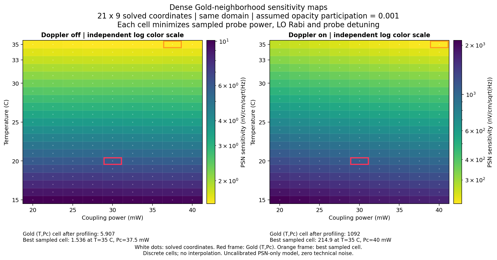
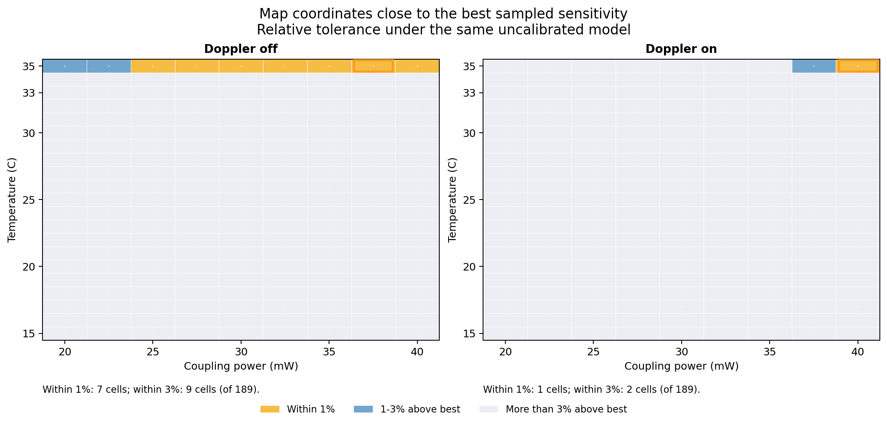
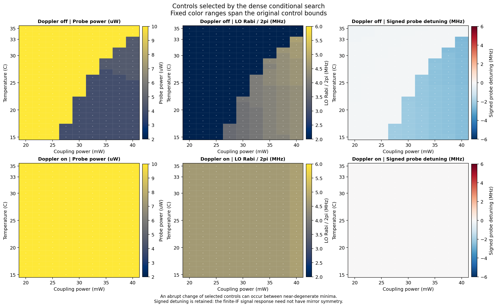
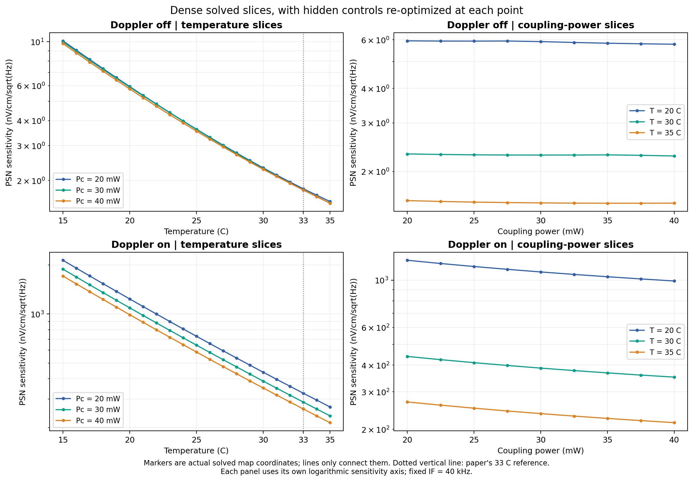
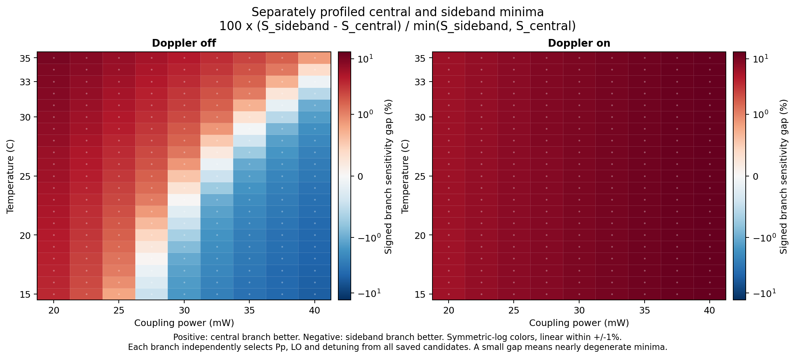

# Ju2026 Gold 주변 — 동일 범위 격자 세분화

사용자 요청: 더 넓은 범위 대신 더 촘촘한 격자로 구성하고 해석.
Gold: 사용자가 채택한 Ju et al. (2026), arXiv:2606.04354v1.

## ⟦AI⟧ 후속 검증 상태 — 2026-11-04

아래 수치는 구형 감쇠 모델의 계산 이력이다. 후속 감사에서 양성성 문제를 수정하고
Gold의 EIT 폭·파워 조건과 PSN 곡선 해석을 바로잡았다.
현재 모델의 예측 인증이나 실험 최적 운전점으로 승계하지 않는다.
[Gold 검증·이론식·변수별 격자 개선 보고서](../rydberg_gold_validation_20261103/README.md)와
[현재 변수 등록표](../rydberg_gold_validation_20261103/current_variable_resolution_registry.csv)를 참조한다.

## ⟦AI⟧ 전체 결과

**동일 범위에서 격자 세분화 완료. 감도 최선값의 변화는 작고, 거의 동등한 운전점과 전환 경계가 더 분명해짐.**
실제 제어 조합 **9320개**, 흡수 스케일별 스코어 **27960개**, 최적 셀 **1134개**.
국소 탐색 반복 상한 도달 **0건**. 8개 프로세스에서 주 계산 약 54.4분.

명목 흡수 참여 스케일 0.001. 감도 단위 **nV/cm/√Hz**, 작을수록 좋음.

| 모델 | 이전 범위 내 최선 | 이번 주 맵 최선 | 감도 감소 | T | Pc | Pp | ΩLO/2π | Δp |
|---|---:|---:|---:|---:|---:|---:|---:|---:|
| 도플러 off | 1.536991 | 1.535845 | 0.07456% | 35 °C | 37.5 mW | 10 µW | 2 MHz | −0.13 MHz |
| 도플러 on | 215.443951 | 214.923602 | 0.24152% | 35 °C | 40 mW | 10 µW | 4.75 MHz | 0 MHz |

두 모드 모두 T·Pp 상한 도달. off는 LO 하한, on은 Pc 상한도 도달.
무제약 연속 최적점 확정 아님. 두 모드의 최선값 차이는 약 **139.94배**로 유지.
Gold의 측정 12.5(8) 또는 PSN 이론 11.2에 대한 피팅 없음. 위 수치는 실험 달성 감도 예측으로 검증되지 않음.



빨간 테두리는 T=20 °C·Pc=30 mW에서 나머지 변수를 재탐색한 셀. Gold의 고정 광파워·LO 기준점과 다름.
두 패널의 색 범위는 독립 로그 척도. 하얀 점은 실제 계산한 좌표.

**결합광 의존성은 모드별 차이.** off에서 T=35 °C·Pc=25–40 mW의 모든 샘플이 최선값의 1% 이내,
20–40 mW 전체는 3% 이내. 35 mW와 37.5 mW의 차이는 불과 약 0.00080%.
on에서는 같은 T에서 Pc=40 mW만 1% 이내, 37.5·40 mW 두 점이 3% 이내.
따라서 넓은 Pc 평탄 구간은 현재 off 모형의 결과이며 두 모드 공통 결론 아님.



on의 최선 좌표에서 저장한 제어 후보 중 감도 1% 이내인 조건은 9개.
Pp 8–10 µW, LO 4.5–5.0 MHz 범위에 분포. 이 범위 안 모든 조합을 검사·허용했다는 뜻은 아님.
최선 Pp·LO 한 쌍만으로 운전 허용도를 판단하기 어려움.



**온도 내부 최적점은 두 모드 모두 확인되지 않음.** 9개 Pc 단면 각각에서 T에 따른 감도는 전 구간 감소.
예를 들어 Pc=30 mW에서 나머지 제어를 재탐색한 값:

| T | 도플러 off | 도플러 on |
|---:|---:|---:|
| 32 °C | 1.940994 | 317.354326 |
| 33 °C | 1.791957 | 287.679995 |
| 34 °C | 1.658746 | 260.969213 |
| 35 °C | 1.539765 | 236.909727 |

이번 가정·최적화 제약에서는 논문의 약 33 °C 최적점 재현되지 않음.
T 간격을 줄여도 해당 영역의 온도 경향은 유지됨. 논문의 다른 이론 가정·고정 제어와 동일한 계산이라는 뜻은 아님.



흡수 참여 스케일별 주변부 최선:

| 가정 스케일 | 도플러 off | 도플러 on |
|---:|---:|---:|
| 0.0005 | 2.677657 | 428.051137 |
| 0.0010 | 1.535845 | 214.923602 |
| 0.0015 | 1.154573 | 143.883602 |

모든 경우 T=35 °C. 모형 가정 변화의 영향이 이번 격자 세분화 효과보다 큼.
이 스케일은 OD 자체가 아님. 선택 주파수에서 계산한 OD=−ln(투과율)는 명목 최선점에서 off 약 0.4889, on 약 0.01675.
실제 주파수·광파워의 OD, EIT 폭·대비와 Rabi 앵커를 함께 대조해야 실험 권장 조건으로 확장 가능.

기존 18개 공통 좌표 비교: off 감도 변화는 최대 0.22979% 개선, 일부 지점은 최대 **0.00543% 악화**.
제어 조합은 중첩 재검사했지만 새 고정 Δp 격자가 기존 LO 의존 격자의 모든 정확한 점을 포함하지 않아 미세한 스냅 차이 존재.
on은 전 공통 좌표에서 0.01565–0.24349% 개선.
[비교·온도 경향·모형 OD](interpretation.json), [렌더링 진단](render_diagnostics.json).

## ⟦AI⟧ 범위·계산 방식

기존 범위 유지. 그림 보간 대신 각 T·Pc 좌표에서 원자 응답 재계산.

| 항목 | 이전 시험 | 이번 시험 |
|---|---|---|
| 온도 | 15,20,25,30,33,35 °C | 15–35 °C, 1 °C 간격 |
| 결합광 Pc | 20,30,40 mW | 20–40 mW, 2.5 mW 간격 |
| 맵 좌표 / 모델 | 18 | 189 |
| 프로브 Pp | 2,4,6,8,10 µW | 같은 2–10 µW 범위, 국소 간격 1→0.5 µW |
| ΩLO/2π | 2,3,3.7,4.5,6 MHz | 같은 2–6 MHz 범위, 국소 간격 0.25→0.125 MHz |
| 프로브 Δp | LO에 따라 달라지는 스펙트럼 격자 | 고정 −6~+6 MHz의 0.01 MHz 스펙트럼 격자 |

도플러 off/on 및 흡수 참여 스케일 0.0005/0.001/0.0015 각각 탐색.
합계 1134개 최적 셀 = 189×2×3. Pp·LO는 적응형 국소 격자. 전체 5변수 직교 격자 전수 탐색 아님.
이전 18개 T·Pc 좌표에서는 기존 5×5 제어 조합도 모두 재계산하여 비교 기준 유지.

L=50 mm, d=0.15 mm, IF=40 kHz, Δc=ΔRF=0, 연결 온도 모형 유지.
QE=0.95, 경로 효율=0.5, 균형 검출 파워비=1. RIN·전자 잡음 0인 **조건부 PSN 감도**.
Rabi 앵커·미보정 흡수 스케일·추가 온도/밀도 탈위상 0 등 기존 물리 가정 그대로.
[기존 전체 가정·문헌 근거](../rydberg_gold_map_20261103/README.md), [동결 입력](../rydberg_gold_map_20261103/resolved_parameters.json).

각 제어 조합에서 유한 IF 응답을 직접 계산. off는 Δp 전역 0.1 MHz 목표점과 각 최적 후보 주변 0.01 MHz 세분화.
on은 전역 0.5 MHz 목표점과 각 후보 주변 0.05 MHz 세분화. 목표점은 고정 0.01 MHz 격자에 스냅.
따라서 스펙트럼 격자 0.01 MHz가 모든 열속도 IF 응답을 0.01 MHz 간격으로 전수 계산했다는 뜻은 아님.
열속도 격자는 각 제어 조합의 전체 고정 스펙트럼 범위에서 한 번 정하고 후보 추가 시 재사용.

두 탐색 구간 유지: `central`은 |Δp|<0.75 MHz, `sideband`는 |Δp|≥0.75 MHz.
이 명칭·경계는 국소 최적 후보 비교용 AI 분류. 동역학적 상전이·쌍안정성을 뜻하지 않음.
각 구간·흡수 스케일에서 교차 이웃 격자 탐색 후, 새로 발견된 후보 전체에 대해 최종 이웃 탐색 재확인.
1%·3% 영역은 **저장한 샘플 중 최선 감도에 가까운 조건**. 신뢰구간 아님.
Pp·LO 허용값의 최솟값/최댓값 사이 모든 조합이 허용된다는 뜻도 아님.

## ⟦AI⟧ 간이 모드의 국소 후보·추가 세분화

명목 스케일 0.001. 감도 단위 nV/cm/√Hz.
189개 좌표 최선: T=35 °C, Pc=37.5 mW, Pp=10 µW, ΩLO/2π=2 MHz, Δp=−0.13 MHz,
**1.53584545**. 이전 최선 1.53699137 대비 **0.07456%** 감소.

Pc 최선이 40→37.5 mW로 이동했지만 개선 폭 매우 작음.
T=35 °C에서 **Pc=25–40 mW의 모든 2.5 mW 샘플이 최선값의 1% 이내**.
20–40 mW 전체는 3% 이내. 단일 Pc를 정밀 최적값으로 읽기보다 평탄한 구간으로 읽는 편이 적절.
T·Pp 상한, LO 하한은 계속 도달. 온도의 무제약 최적값은 확인되지 않음.

Gold의 T=20 °C·Pc=30 mW 좌표에서 Pp·LO·Δp 재탐색: 5.90678397,
Pp=4 µW, LO=3.75 MHz, Δp=−2.20 MHz. 다른 중심 근처 후보도 감도 1% 이내 존재.
선택된 제어값이 바뀌어도 감도 표면에 큰 단차가 생겼다는 뜻은 아님.

대표 전환 구간 T=23 °C·Pc=30 mW:

| 후보 구간 | Pp | ΩLO/2π | Δp | 감도 |
|---|---:|---:|---:|---:|
| 중심 근처 | 10 µW | 2 MHz | −0.11 MHz | 4.39101119 |
| 떨어진 공명 위치 | 4 µW | 3.875 MHz | −2.25 MHz | 4.39191612 |

감도 차이 **0.02061%**. 제어 지도에서는 Pp·LO·Δp가 크게 달라지는 경계지만 감도상 거의 동등한 두 운전점.

별도 검사: Gold 좌표·전체 최선 좌표·가장 가까운 전환 좌표의 **양쪽 후보**에서
Pp 0.25 µW, LO 0.0625 MHz, Δp 0.005 MHz로 추가 세분화.
107개 제어점, 321개 스코어. 각 후보 감도 변화 최대 **0.03403%**.
Gold 최선 5.90648402, 전체 최선 좌표 1.53584353. 전환 좌표의 후보 차이 **0.01530%**, 검사 범위에서 선택 뒤집힘 없음.
[추가 세분화 결과](off_branch_refinement.json), [추가 제어점 CSV](off_branch_refinement.csv).



각 구간에서 Pp·LO·Δp를 별도로 선택한 최소값 비교.
off의 제어 지도 경계는 두 후보의 미세한 우열 전환. on에서는 중심 근처 후보가 전 범위 우세.

## ⟦AI⟧ 수치 가정 점검

**디튜닝 양쪽 모두 유지.** 정적 투과율은 ±Δp 대칭이지만, 고정 유한 IF의 약한 SIG 응답 크기는 대칭 아님.
Gold off에서 ±1.5 MHz 응답 크기 차이 약 3.46%. 반쪽 디튜닝만 계산하는 단축법은 실행 전 검사에서 기각.
[부호 검사](symmetry_check.json). 이번 전체 캠페인은 이 단축법 사용 안 함.

열속도 적분 독립 사전 검사: Gold 광파워·LO의 Δp=0, 이전 주변부 최선 조건의 Δp=0.
속도 간격 dv→dv/2→dv/4, 속도 범위 6σ→8σ 확장.
복소 응답 상대 변화 최대 **1.97×10⁻⁹**. 기존 감도 재현 상대 차이 ≤7.2×10⁻¹².
[사전 검사](quadrature_preflight.json).
따라서 이 두 조건에서 도플러 off/on의 큰 차이는 열속도 적분 격자 오차로 설명되지 않음.

같은 Gold 제어·Δp=0에서 속도군별 응답 진폭 평균/정지 원자 진폭 `A≈0.02197`,
복소 평균의 위상 상쇄 계수 `C≈0.62877`, 곱 `AC≈0.01382`.
현재 열속도 모형에서는 유효 응답 진폭 참여와 속도군 간 위상 상쇄가 크게 작용.
이는 **같은 디튜닝의 원자 응답 비교**이며, 서로 다른 디튜닝까지 재최적화한 감도의 비율과 다름.

모형 밀도는 20→35 °C에서 약 4.77배 증가. 반면 transit 탈위상은 0.15254→0.15639 MHz.
추가 온도·밀도 탈위상 계수는 0. 밀도 증가 이득이 우세한 현 설정과 논문의 33 °C 예측을 구분해야 함.
격자 세분화 자체가 누락된 실험 물리나 미보정 OD/Rabi 앵커를 보완하지는 않음.

## ⟦AI⟧ 최종 검증

[검증 기록](validation.json): **30항목 PASS**.
1134개 셀 완전성·유일성, 이전 900개 제어 조합 재계산, 동결 소스·입력·환경 서명,
저장 최소값·두 후보 구간별 최소값·1%/3% 샘플 일치, 독립 균형 검출 PSN 및 단위 재구성,
반복 상한 미도달, 추가 off 검사 해시·189개 off 스냅샷 일치 포함.

대표 다섯 조건의 인접 제어 조합 전수 검사: 고정 Δp 0.005 MHz,
열속도 IF 목표 간격 0.25/0.025 MHz.
주 맵 최선 대비 감도 변화 최대 약 **0.000416%**, 선택 Pp·LO 유지.
별도 더 촘촘한 off 제어 격자 107점 검사는 위 국소 후보 절에 기록.
두 검사는 서로 다른 제어 분해능·목적이므로 수치 차이 구분 필요.

최종 Gold 좌표의 재최적화 조건과 on 최선점에서 독립 속도 격자 검사도 통과.
dv/4·8σ 기준과 복소 응답 차이 약 **2×10⁻⁹ 이하**.
적응형 탐색의 전체 연속 최적점이나 실험 예측 정확도를 인증하는 검사는 아님.

그림 5장 육안 확인. 코드 AST·로컬 링크·산출물 해시 검사 포함.
관련 엔진 테스트 32개 통과 결과는 이전 시험에서 재사용. 해당 엔진 코드 변화 없음.
전체 회귀·GC 캠페인은 공유 엔진 변경 없어 생략.

산출물: [전체 최적 셀](optima.csv), [전체 제어점](control_points.csv),
[후보 구간별 차이](branchgaps.csv), [1%/3% 제어 샘플 범위](epsilon_bands.csv),
[전체 결과](results.json), [설정](config.json), [수치 소스·환경](source_manifest.json),
[그림 해시](render_manifest.json).

## ⟦AI⟧ 재현

동일 저장소·환경에서:

```powershell
python -X utf8 -B analysis/rydberg_gold_dense_20261103/dense_study.py --workers 8
python -X utf8 -B analysis/rydberg_gold_dense_20261103/interpret_dense.py
python -X utf8 -B analysis/rydberg_gold_dense_20261103/render_dense.py
python -X utf8 -B analysis/rydberg_gold_dense_20261103/verify_dense.py --local-checks 3 --quadrature-checks 2
python -X utf8 -B analysis/rydberg_gold_dense_20261103/refine_off_branches.py
```

재개 서명: 수치 코드·입력·Python/NumPy/SciPy 환경 포함. 체크포인트의 손상된 마지막 줄은 백업 후 복구 가능.
공유 엔진·UI·Gold 문헌 DB 수정 없음. 이번 변경은 별도 분석 파일만 추가.
