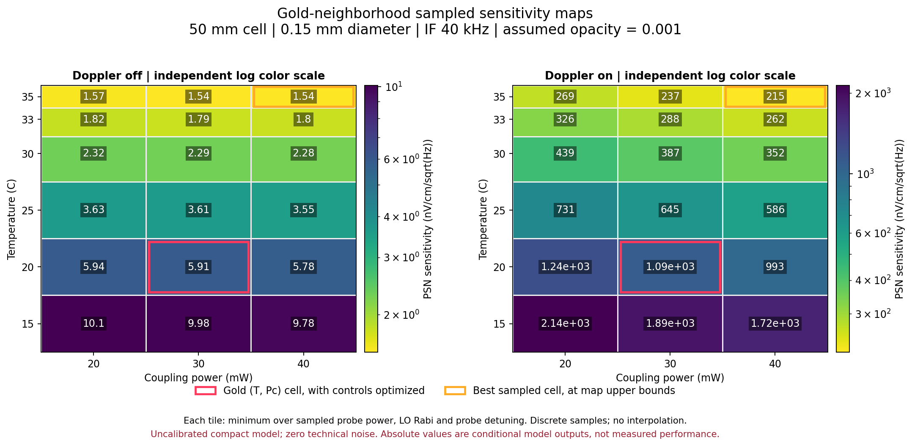
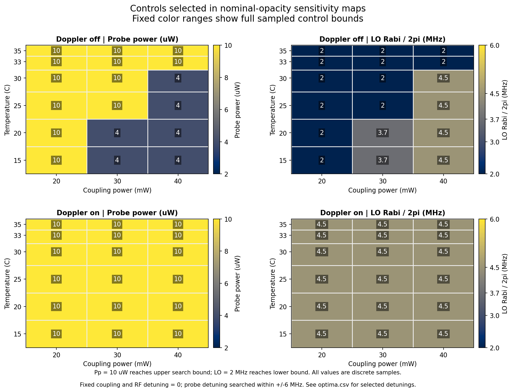

# Ju2026 Gold 주변 다변수 맵 시험 — 2026-11-03

사용자 요청: Gold 주변 최적 맵 시험. Gold 조건 불완전하면 Ju의 이전 연구 참조.
Gold 채택: Ju et al. (2026), *Photon shot-noise-limited Rydberg-EIT electrometry*, arXiv:2606.04354v1.

## ⟦AI⟧ 결과

**계산 완료. 현재 모델로 조건부 맵 생성 가능. 실험 최적점·절대 감도의 예측 검증은 미완료.**
두 도플러 설정의 예측 차이가 내부 최적화 이득보다 훨씬 큼. 최선점은 탐색 경계 도달.

명목 흡수 참여 스케일 `effective_opacity_participation=0.001`. 아래 단위 모두 **nV/cm/√Hz**.
기준점은 Gold 광파워·LO·구도 고정 후 **프로브 디튜닝만 최소화**한 모델값. 논문의 정확한 광학 운전점 재현값 아님.

| 모델 | Gold 기준점 | Gold의 T·Pc 좌표에서 Pp·LO·Δp 탐색 | 전체 주변부 최선 | 기준점 대비 개선 배수 |
|---|---:|---:|---:|---:|
| 도플러 off, 간이 비교 | 6.0824 | 5.9120 | 1.5370 | 3.957× |
| 도플러 on, 열속도 평균 | 1142.2232 | 1092.7615 | 215.4440 | 5.302× |

| 모델 | 최선 T | 최선 Pc | 최선 Pp | 최선 ΩLO/2π | 최선 Δp | 경계 도달 |
|---|---:|---:|---:|---:|---:|---|
| 도플러 off | 35 °C | 40 mW | 10 µW | 2 MHz | −0.12990 MHz | T·Pc·Pp 상한, LO 하한 |
| 도플러 on | 35 °C | 40 mW | 10 µW | 4.5 MHz | 0 MHz | T·Pc·Pp 상한 |

Gold 보고값: 측정 **12.5(8)**, PSN 이론 **11.2 nV/cm/√Hz**. 이 값에 대한 피팅 없음.
도플러 on/off 차이: 기준점 **187.79배**, 각 모드 최선값 **140.17배**.
따라서 1.54 또는 215라는 절대값을 실험 달성 감도로 해석 불가.
이번 맵에서는 논문의 약 **33 °C 내부 최적점 확인되지 않음**. 온도·밀도 추가 탈위상 계수 모두 0인 현재 설정과 광파워 재최적화 범위 함께 고려 필요.



빨간 테두리: T=20 °C, Pc=30 mW 좌표에서 나머지 변수를 재탐색한 셀.
표의 고정 Gold 기준점과 값 다름. 주황 테두리: 전체 샘플 중 최선 셀.
두 패널 색 범위 각각 독립 로그 척도. 각 숫자 자체 비교 필요. 타일은 이산 샘플 표시이며 연속 보간 아님.



## ⟦AI⟧ 시험 범위·목적함수

각 T·Pc 좌표에서 다음 조건부 최소값 산출.

\[
S_E^*(T,P_c\mid D,\eta_{op})=
\min_{P_p,\Omega_{LO},\Delta_p\;\text{sampled}}
\frac{\sqrt{S_i(f_{IF})}}{|H_{IE}(f_{IF})|},\qquad f_{IF}=40\;\mathrm{kHz}.
\]

`S_E`는 전기장 잡음 진폭 스펙트럼 밀도. `H_IE`는 약한 SIG에 대한 유한 IF 전류 응답.
현재 같은 파워의 균형 검출 두 팔, 기술 잡음 0 → 전류 PSN `sqrt(4 e I_signal)`.
DC 투과율 기울기를 IF 감도로 바로 대체하지 않음.

| 변수 | 샘플·고정값 | 출처·역할 |
|---|---|---|
| T | 15, 20, 25, 30, 33, 35 °C | AI 선정 주변 범위. 유효 온도·cold spot 연결 |
| Pc | 20, 30, 40 mW | AI 선정 맵 축 |
| Pp | 2, 4, 6, 8, 10 µW | 각 셀 내부 탐색 |
| ΩLO/2π | 2, 3, 3.7, 4.5, 6 MHz | 각 셀 내부 탐색 |
| Δp | 약 ±6 MHz 이내 기존 스펙트럼 격자 | 각 셀 내부 탐색. 격자 스냅 허용 약 0.03 MHz |
| Δc, ΔRF | 각각 0 | 고정. 독립 Δc 제어는 현재 모델 미지원 |
| L, d, IF | 50 mm, 0.15 mm, 40 kHz | Gold 메인 조건 유지 |
| 도플러 | off / on | 동일 앵커의 모델 가정 비교 |
| ηop | 0.0005 / 0.001 / 0.0015 | 미보정 흡수 참여 스케일 가정 3종 |

기본 제어 상태 **900개** = 2×6×3×5×5. 열속도 모드 추가 정밀 탐색 **37개**.
각 상태에 흡수 스케일 3종 후처리 → 저장 행 **2811개**, 최적 맵 셀 **108개**.
공유 원자 응답 재사용은 흡수 참여 스케일이 OBE에 역작용하지 않는 현재 모델에 한정.

도플러 off: 기본 801점 스캔 중 범위 내 모든 점에서 유한 IF 응답 사용.
도플러 on: ±6 MHz의 13개 목표점과 정적 기울기 후보를 합친 후 **모든 후보에서 유한 IF 응답 직접 계산**.
각 셀·스케일 상위 2개 제어 조합에서 후보 디튜닝 주변 ±1 MHz, 25개 목표점 추가.
Gold 기준점·최선점은 별도 41개 전역+41개 국소 목표점 재검사. 격자 중복 제거 후 67/63개, 저장값과 일치.
Pp·LO 연속 최적화 및 열속도 적분 격자 수렴은 이번 범위 밖.
이전 대화의 **+40 MHz 위치는 이번 ±6 MHz 국소 탐색에 포함되지 않음**.

## ⟦AI⟧ 가정 민감도

각 흡수 스케일에서 제어값 다시 선택. 통계적 오차막대·신뢰구간 아님.

| ηop | 도플러 off 주변부 최선 | 도플러 on 주변부 최선 |
|---:|---:|---:|
| 0.0005 | 2.6809 | 429.1217 |
| 0.0010 | 1.5370 | 215.4440 |
| 0.0015 | 1.1546 | 144.2205 |

모든 스케일에서 최선 T=35 °C, Pc=40 mW. off의 0.0005 시나리오에서는 Pp=4 µW, LO=4.5 MHz로 선택 제어까지 변경.
흡수 스케일은 감도와 최적 제어 선택 모두에 영향.

현재 결과에 함께 적용되는 가정:

- 간이 4준위 OBE, 단일 유효 흡수·Beer–Lambert 후처리. Gaussian 공간 전파·국소 고갈·전체 hyperfine/Zeeman manifold 미포함.
- 프로브 Rabi 앵커 Ωp/2π=2 MHz at 6 µW·0.15 mm, 결합광 앵커 3 MHz at 30 mW. 완전한 빔·부분준위로부터 독립 산출한 Gold 보정값 아님.
- RF 쌍극자 1326.257 ea0, angular factor=1, 전기장 RMS 규약. Gold의 실제 편광·부분준위 평균과의 대응 미확정.
- 검출 QE=0.95, 경로 효율=0.5, reference/signal 파워비=1. RIN·전자 잡음 0. 레이저 주파수 잡음 PSD 변환 항 없음.
- 추가 온도·밀도 탈위상 계수 0. 현상론적 기본 탈위상은 포함되나, 그것이 주파수 잡음 PSD를 대체하지 않음.
- `ηop=0.001` 및 ±50% 시나리오는 측정 OD에서 추정한 값 아님. 이 스케일 자체가 OD도 아님. 실제 주파수·광파워에서의 투과율/OD와 EIT 폭·대비를 동시에 대조해야 함.

전체 기본값 [resolved_parameters.json](resolved_parameters.json), 엔진·수치 스크립트 해시 및 환경 [source_manifest.json](source_manifest.json).
도플러를 켜는 것만으로 실험 예측이 개선됐다고 주장할 근거 없음. 흡수·Rabi·속도군 가중치·부분준위 모델의 공동 대조가 먼저 필요.
그 뒤 기술 잡음·IF 대역폭을 포함해 감도–대역폭 Pareto 경계 확장 가능. 이번 시험은 **고정 IF의 감도 맵**.

## ⟦AI⟧ Gold·이전 연구 적용

Gold 원문 [arXiv:2606.04354v1](https://arxiv.org/abs/2606.04354v1).
추출·페이지 근거 [Gold DB 레코드](../../references/rydberg_experiments/papers/ju_2026_preprint.json).
50 mm·20 °C: PDF p.9. 6 µW·30 mW·0.15 mm: p.3. 3.7 MHz LO·40 kHz IF: pp.2,5.
33 °C 예측 최적 온도: p.9 Fig.5(a). 12.5(8) 측정·11.2 PSN: pp.7–10.

Gold의 0.15 mm는 원문상 **diameter**. 1/e²/FWHM 규약, 동위원소 순도, 절대 광학 디튜닝·운전 OD 미확정.
본문 F=3→F′=4와 Fig.1(a)의 F=2→F′=3 불일치도 DB 그대로 보존.

Ju의 2025 부산대 석사학위논문 원문 확보·장치 그림 확인.
[학위논문 공식 레코드](https://dcollection.pusan.ac.kr/srch/srchDetail/000000167386),
[보관 PDF](sources/ju_2025_thesis.pdf), [페이지별 추출·해시](sources/prior_work.json).

| 이전 연구 근거 | 확인 내용 | 이번 적용 |
|---|---|---|
| 2025 학위논문 본문 p.28 / PDF p.37 | 같은 40D5/2–39F7/2, 약 37.07 GHz | 준위·RF 연결 확인 |
| 본문 p.29 / PDF p.38 | 자연 동위원소 15 mm 정육면체 셀, 역전파·직교 선편광, 균형 검출 | Gold와 다른 장치로 구분 |
| 같은 페이지 | focused “beam waists” 170/54 µm, probe/coupling 20 µW/31 mW | Gold 0.15 mm·6 µW에 대입 안 함. waist 규약도 불명 |
| 본문 p.30 / PDF p.39 | 기존 레이저 각각 linewidth ≤1 MHz | Gold ULE 조건 대체 안 함 |
| 본문 p.32 / PDF p.41 | RF 쌍극자 1002.544 ea0 | Gold 편광·Zeeman 유효값 확인 과제로 보존 |

이전 쌍극자로 단순 변환하면 감도 약 1.323배 변화. 두 모드 간 140–188배 차이 설명 불가.
이전 논문의 20 µW는 EIT 가시도 설정이며 Gold 전기장 감도 최적 Pp와 다른 목적.
학위논문에서 수치 실험 온도 및 Gold 빔 정의를 보완할 근거는 찾지 못함.

[Ju DAMOP 2024](https://meetings-archive.aps.org/damop/2024/k00/73/)는 51D–50F의 다른 쌍.
[Ju DAMOP 2026](https://meetings-archive.aps.org/damop/2026/h00/97/)는 같은 40D–39F, 13.3 nV/cm/√Hz를 보고한 선행 초록.
추가 장치 수치 부족. Gold 12.5(8)과 병합·평균하지 않음.

## ⟦AI⟧ 검증·재현

- [독립 검증](validation.json): **19개 PASS**. 900개 격자 완전성, 108개 최적 셀, 원문·엔진 해시, 양수·유한값, 수동 투과율, 저장 최소값 일치, 독립 균형 PSN/단위 재구성, 기본점 재계산, 열속도 디튜닝 추가 탐색 포함.
- 관련 엔진 테스트: `python -X utf8 -B -m pytest -q tests/test_rydberg_electrometry.py tests/test_rydberg_opacity.py` → **32 passed**, 기존 `datetime.utcnow()` DeprecationWarning 2건, 10.16 s.
- 이미지 두 장 육안 확인. 제어값 색 범위 고정, 비균등 T 축 간격 반영. 렌더링 해시 [render_manifest.json](render_manifest.json).
- 전체 수치 엔진·UI·Gold DB 수정 없음. 독립 분석 파일만 추가. 공유 엔진 변경 없으므로 전체 회귀·GC 캠페인 생략.

저장소 루트, 같은 엔진 해시·Python 3.14.2·NumPy 2.4.1 환경에서 실행:

```powershell
python -X utf8 -B analysis/rydberg_gold_map_20261103/pilot.py --workers 2
python -X utf8 -B analysis/rydberg_gold_map_20261103/render_maps.py
python -X utf8 -B analysis/rydberg_gold_map_20261103/verify_pilot.py
```

기존 체크포인트 재사용 가능. 수치 파일·입력 해시가 달라지면 중단하도록 구성.
재개 서명에 Python/NumPy 자체는 포함 안 됨. 환경은 최종 manifest와 별도 대조.
체크포인트 마지막 줄이 손상된 경우 자동 복구 미지원. 원본 보존 후 처리 필요.

산출물: [최적 셀 CSV](optima.csv), [전체 제어점 CSV](control_points.csv),
[결과 JSON](results.json), [설정](config.json), [수치 실행 코드](pilot.py), [검증 코드](verify_pilot.py).
