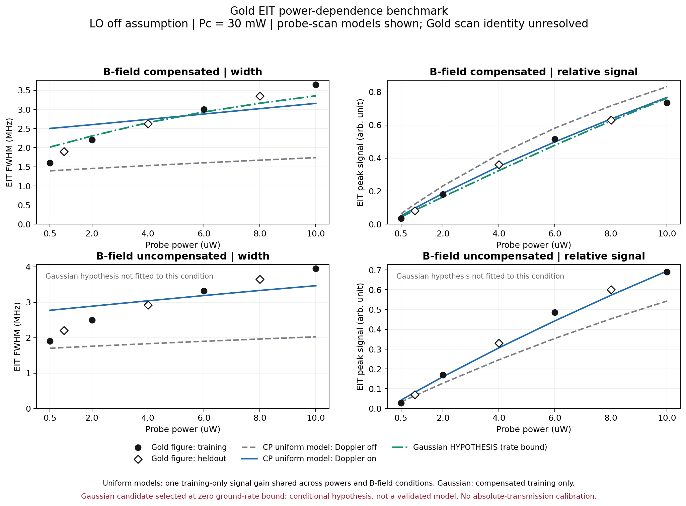
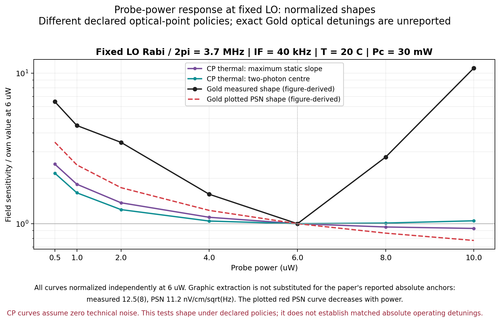
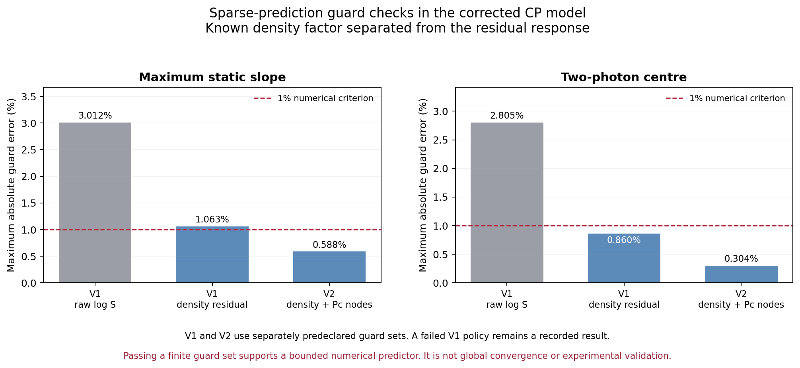

# Ju2026 Gold 검증과 최적화 분석 개선

사용자 요청: Gold와 같은 LO·디튜닝 조건에서 투과율, EIT 폭·대비와 프로브 파워 의존성을 먼저 검증하고, 그 결과로 이론식·변수·격자를 개선한다. 어떤 변수를 성기게 계산할 수 있는지도 보고서에 남긴다.

Gold는 사용자가 지정한 Ju et al. (2026), *Photon shot-noise-limited Rydberg-EIT electrometry*, [arXiv:2606.04354v1](https://arxiv.org/abs/2606.04354v1)이다. 작업 시작일 2026-11-03, 정리일 2026-11-04.

## ⟦AI⟧ 판단과 완료 범위

**이론식의 물리적 일관성과 격자 설계는 개선했다. Gold 실험의 정량적 재현은 아직 성립하지 않는다.** 기존의 9320개 제어 조합을 다시 전수 계산하기보다, 원문 재추출 → 고정 조건 비교 → 모델 진단 → 새 모델에서의 독립 검증점 확인 순서로 바꿨다.

- 기존 감쇠식에서 음의 밀도행렬 고유값을 확인하고, 생산 모델을 완전 양성인 Lindblad 채널로 수정했다.
- 프로브·결합광 디튜닝과 스캔 축을 독립적으로 구현했다. 정적 스펙트럼과 유한 IF 응답이 같은 Hamiltonian을 사용한다.
- Gold의 파워별 EIT 폭·상대 피크 신호를 추출하고, 학습에 쓰지 않은 파워에서 비교했다. 절대 투과율·물리적 대비는 원문만으로 식별되지 않는다.
- 온도–결합광 파워를 희소 단면으로 예측하는 규칙을 새 모델에서 재검증했다. 실패한 최초 규칙도 보존했다. 결합광 축 두 점 추가 후, **새 검증점 8개에서 최대 오차 0.588% / 0.304%**였다.
- 변수별 역할·추천 격자·오차·적용 범위·무효화 조건을 [현재 변수 등록표 CSV](current_variable_resolution_registry.csv)와 [JSON](current_variable_resolution_registry.json)에 남겼다.

이 오차는 **명시한 계산 모델의 감도 예측 오차**다. 실험 오차나 Gold 감도 재현 오차를 뜻하지 않는다. 1% 기준도 이번 분석의 수치 설계 기준이며, 사용자 등록 목표나 실험 불확도가 아니다.

## ⟦AI⟧ 원문에서 고정할 수 있는 조건과 없는 조건

근거는 [원문 PDF](../../references/rydberg_experiments/sources/ju_2026_preprint.pdf), [추출 데이터·프로토콜](sources/gold_observations.json), [스캔 축 조사](sources/scan_axis_audit.json), [보충자료 조사](sources/supplement_search.json)다. PDF SHA-256은 `45494b6d13a3670a6e0b200e0189685f5879368970321c26ab47cddcf26c6d13`.

| 항목 | 이번 비교 조건 | 근거와 상태 |
|---|---|---|
| 원자·준위 | 85Rb, 5S–5P–40D–39F의 유효 4준위 | 본문은 F=3→F′=4; 그림의 다른 hyperfine 표기와 충돌은 DB에 보존. 동위원소 순도 미상 |
| 온도·셀·빔 | 20 °C, 50 mm, 직경 0.15 mm | Gold 명목 조건. 빔 직경의 구체적 정의·공간 분포는 미확정 |
| 결합광 | 30 mW, Ωc/2π=3 MHz | 보고값. 3 MHz가 Gaussian 중심값인지 유효 평균값인지는 미상 |
| 프로브 파워 | 0.5, 1, 2, 4, 6, 8, 10 µW | Fig. 2(b), 4, 5의 비교 좌표 |
| EIT 분광의 LO | 0 MHz로 계산 | Fig. 2의 단일 피크와 절 순서에 따른 추론. 명시적인 RF-off 문장은 없음 |
| RF 판독의 LO | ΩLO/2π=3.7 MHz, carrier 37.07104 GHz | 명목 보고값. 파워마다 재최적화했는지 완전히 고정했는지 본문에 모호함이 남음 |
| IF | 40 kHz | Gold 보고값 |
| RF 디튜닝 | ΔRF=0으로 계산 | carrier는 보고되지만 독립적인 원자 공명 영점 교정은 없음. 분석 가정 |
| 광학 스캔 축 | probe scan과 coupling scan을 각각 계산 | Gold의 `Frequency (MHz)` 축은 어느 레이저를 스캔했는지 명시하지 않음 |
| 광학 절대 디튜닝 | 고정 상대 레이저 Δ=0을 기준 가설로 사용 | Gold의 수치가 보고되지 않음. 정확한 실험 운전점 일치로 부를 수 없음 |
| 절대 T·OD·정규화 대비 | 검증값을 만들지 않음 | Fig. 2가 임의 신호 단위이며 입사광·dark·검출 이득 교정이 없음 |

이전 Ju 논문·학위논문은 스캔 방식의 후보를 제공하지만 다른 장치 조건이다. 예컨대 Ju2025 학위논문에는 프로브 스캔이 명시되어 있으나, 이를 Gold의 확정 프로토콜로 옮기지 않았다. 보충자료는 확보하지 못했으며, `/src`·`/e-print`에서 받은 파일도 동일한 본문 PDF였다. 따라서 이번 상태는 `PARTIAL_MATCH`다.

### ⟦AI⟧ 이전 해석에서 바로잡은 두 기준

1. **1.6 MHz를 6 µW에 묶으면 안 된다.** Fig. 2(a)의 1.6 MHz 스펙트럼은 Pp가 미상이다. Fig. 2(b)의 자기장 보상 데이터는 Pp=[0.5, 1, 2, 4, 6, 8, 10] µW에서 폭이 약 [1.601, 1.901, 2.201, 2.620, **3.000**, 3.350, 3.650] MHz다.
2. **6 µW 부근 최소는 측정 감도 곡선이다.** Fig. 5(b)의 빨간 PSN 이론선은 약 Pp^−0.502로 계속 감소한다. 따라서 PSN 모델에 6 µW 최소를 강제로 만들지 않는다. 본문 보고 감도 12.5(8), PSN 11.2 nV/cm/√Hz와 그림에서 읽은 약 13.4·11.8도 별도 값으로 보존했다.

두 수정은 [Gold 레코드](../../references/rydberg_experiments/papers/ju_2026_preprint.json)와 재생성한 레퍼런스 DB에도 반영했다. 0.03 MHz·0.005 arb는 분석자가 정한 보수적인 그림 비교 허용폭이며, 측정된 추출 불확도·실험 표준오차·신뢰구간이 아니다.

## ⟦AI⟧ 이론식과 실제 구현의 개선

### ⟦AI⟧ 감쇠 채널의 양성성

기존 모델은 서로 독립적으로 넣은 coherence 감쇠율의 조합이 Lindblad 생성자를 이루지 못했다. [구형 생성자 진단](diagnostics/generator_audit.json)에서 conditional Choi 최소 고유값을 2π×10⁶ s⁻¹로 나눈 값은 −0.34098이고, 표본 정상상태 ρ의 최소 고유값은 **−1.7495×10⁻⁵**였다. 작더라도 유효한 밀도행렬이 아니다.

현재는 |0⟩=5S, |1⟩=5P, |2⟩=40D, |3⟩=39F에 대해 다음 위상 잡음 채널을 사용한다.

```text
Lopt = sqrt(2 γd) diag(0, 0, 1, 1)
Lrf  = sqrt(2 γrf) diag(0, 0, 0, 1)
D[L]ρ = LρL† − {L†L, ρ}/2
```

그러면 추가 coherence 감쇠율은 γ02=γd, γ23=γrf, γ03=γd+γrf로 함께 정해진다. γd·γrf가 유한한 비음수이면 GKSL 형태가 유지된다. 이 변경은 필요한 물리적 일관성 수정이다. 현재 transit 효과는 여전히 **유효 위상 감쇠**이며, 원자의 유입·유출과 population reset을 완전히 기술한 모델은 아니다.

### ⟦AI⟧ 독립적인 광학 디튜닝

회전 좌표계의 대각 성분은 각주파수 단위로 다음과 같다.

```text
H/ℏ diagonal = [0, −Δp, −(Δp+Δc), −(Δp+Δc+ΔRF)]
```

UI·정적 계산·유한 IF 응답·캐시·내보내기에 `scan_axis`, `probe_detuning_mhz`, `coupling_detuning_mhz`를 반영했다. 한 광학 디튜닝만 움직여 one-photon과 two-photon 조건을 묶던 한계를 줄였다. 명목 스캔 중심은 Δp+Δc=0이다.

**범위 제한:** 이 중심은 bare resonance이며 fitted peak가 아니다. 현재 EIT feature 추정은 이 중심에서 시작한다. 큰 고정 디튜닝에서는 Doppler 속도 선택·광 시프트로 실제 피크가 이동할 수 있으므로, 이번 폭 비교는 **고정 광학 디튜닝 0인 Gold 기준 가설**에 한정한다. 독립 디튜닝 ±2 MHz의 RF 응답 파일은 전 디튜닝 범위의 EIT 폭 검증을 대신하지 않는다. 예전 대화의 +40 MHz 같은 조건에는 피크 추적·스캔 경계 검사가 별도로 필요하다.

생산 코드: [Rydberg scheme](../../gabes/schemes/rydberg.py), 모델 태그 `correlated_phase_lindblad`, SHA-256 `e967843a91ee4e39b14153997679e3f8130a3987da316d957b543e45edf6c15b`. 프로브 Rabi anchor는 6 µW·0.15 mm에서 2 MHz로 명시적으로 남기고, 잘못된 1.6 MHz 조건을 근거로 했던 설명을 제거했다. Gaussian 진단의 후보 파라미터는 기본값으로 채택하지 않았다.

## ⟦AI⟧ 투과율·EIT 폭·상대 신호 검증

[비교 코드](benchmark_gold.py)는 EIT에서 LO=0, RF 판독에서 LO=3.7 MHz를 구분한다. Pp=[0.5, 2, 6, 10] µW에서만 양의 검출 이득 하나를 정하고, [1, 4, 8] µW를 독립 비교용으로 남겼다. 같은 모델·스캔 축에서는 **보상/미보상 양쪽과 모든 파워에 같은 이득**을 적용했다.

검출 신호 가설은 A=G·Pp·ΔT, ΔT=T(center)−T(floor)다. ΔT는 투과율 차이며, (Tpeak−Tbackground)/Tbackground 같은 정규화 대비와 다르다. 임의 단위의 A를 맞추는 G만으로 절대 T나 OD가 정해지지 않는다.

| 균일 빔 CP 모델 | 학습 제외 파워의 폭 RMSE (MHz) | 상대 신호 RMSE (arb) |
|---|---:|---:|
| Doppler off, probe scan | 1.1903 | 0.08302 |
| Doppler off, coupling scan | 0.5697 | 0.03176 |
| Doppler on, probe scan | **0.4107** | 0.01754 |
| Doppler on, coupling scan | 1.7546 | 0.01291 |

표는 보상/미보상 조건을 합친 6개 검증값이다. 작은 신호 오차만으로 스캔 축을 선택하면 폭을 크게 틀릴 수 있다. 어느 가설도 모든 분광량을 그림 해상도에서 재현하지 못했다.

예를 들어 Doppler on/probe scan, Pp=6 µW에서 계산 폭은 보상 2.8786 / 미보상 3.1868 MHz이고, 그림은 3.0001 / 3.3198 MHz다. 같은 계산의 보상 상태 T(center)=0.99660, ΔT=0.001819는 **미교정 흡수 참여 스케일 η=0.001에서의 모델 출력**이며 실측값이 아니다. Gold 절대 투과율·대비 검증 상태는 `NOT_IDENTIFIABLE`로 남겼다.



숫자 전체: [spectroscopy_comparison.csv](spectroscopy_comparison.csv), [스펙트럼 배열](matched_spectra.npz), [판정 JSON](benchmark_results.json).

### ⟦AI⟧ Gaussian 빔·파라미터 후보를 시험한 결과

[진단 프로파일](diagnostics/linewidth_profiles.json)에서 기존/CP/CP+population-reset 후보를 비교했다. 이어 [Gaussian 시험](diagnostics/gaussian_trial.json)은 동일 반경의 Gaussian probe/coupling, Ωc,peak/2π=3 MHz라는 **추가 가설**에서 국소 T(r)를 광강도로 가중 적분했다. χ를 평균한 뒤 지수화하지 않았다.

보상 상태의 학습 파워 4개로 γd·프로브 peak Rabi·η의 유한 후보를 평가했다. 선택 후보는 γd=0 MHz, probe peak anchor=4 MHz, η=0.1로 **γd 하한에 도달**했다. 학습 제외 3개 파워에서 폭 RMSE=0.1642 MHz, 최대 오차=0.2091 MHz, 신호 RMSE=0.02115 arb였다. 같은 보상 조건에서 균일 CP/Doppler on/probe scan 폭 RMSE는 0.4181 MHz다. 폭 형상은 개선되지만 신호·양쪽 자기장 조건의 공동 재현은 입증되지 않았다.

γd는 방사 붕괴 외에 넣는 추가 위상 감쇠율이다. 후보 선택의 γd=0을 실제 원자의 감쇠율로 채택하지 않았다. 공간 평균·transit·전파·준위 참여 등의 모형 누락을 다른 파라미터가 대신 흡수할 수 있다. Ωc=3 MHz의 peak 해석도 미확정이다. 결과 상태는 `NOT_REPRODUCED_AT_FIGURE_RESOLUTION`이며, 생산 모델에 피팅값을 적용하지 않았다.

선택 후보에서 radial 12점/주파수 간격 0.0333 MHz와 24점/0.01 MHz를 비교한 최대 폭 차이는 **0.000133 MHz**, 상대 신호 차이는 **4.74×10⁻⁶**였다. 이 경우 수치 격자를 더 촘촘하게 만드는 효과보다 물리 모델 잔차가 훨씬 크다. 두 수치 설정을 함께 바꾼 비교이므로 radial·주파수 오차를 따로 식별하거나 전 파라미터 영역으로 일반화하지 않는다.

## ⟦AI⟧ Gold 명목 LO에서의 프로브 파워 의존성

LO=3.7 MHz, IF=40 kHz를 고정하고, 각 파워에서 아래 두 광학 운전 규칙을 별도로 계산했다.

- `maximum_static_slope`: 정적 스펙트럼의 최대 기울기 후보 양쪽에서 **유한 IF 응답**을 계산한다. 전체 디튜닝에 대한 전역 최적화는 아니다.
- `bare_two_photon_center`: Δp+Δc=0에서 유한 IF 응답을 계산한다. 논문이 이 점에서 운전했다는 뜻은 아니다.

현재 Doppler on/probe scan, 미교정 η=0.001에서 Pp=6 µW 감도는 각각 **2221.2 / 1495.9 nV/cm/√Hz**다. 이는 Gold의 PSN 보고값 11.2와 크게 다르다. 각 곡선을 6 µW 값으로 정규화한 아래 그림은 **모양만** 비교하며, 이 절대 불일치를 제거한 교정으로 사용하지 않는다.



정적 기울기 규칙의 CP 곡선은 0.5→10 µW에서 계속 개선되고, 중심 규칙은 6 µW 부근에 얕은 최소가 나타난다. 측정 곡선의 큰 고파워 악화는 재현되지 않는다. 현재 모델은 기술 잡음을 0으로 두므로 PSN 출력과 측정 총잡음을 같은 곡선으로 해석할 수 없다. 또한 고정 LO 결과와 Pp·LO를 동시에 재탐색한 과거 최적 맵의 경계 도달을 서로 대체하지 않는다.

원자료: [fixed_lo_rf.csv](fixed_lo_rf.csv), [독립 광학 디튜닝 시험](independent_detuning_pilot.csv). 감도 11.2 또는 온도 최적점 약 33 °C에 대한 피팅은 하지 않았다.

## ⟦AI⟧ 어떤 변수를 성기게 계산할 수 있는가

예측 가능성 자체를 결과 데이터로 보존한다. 온도가 중요하지 않거나 선형이라는 뜻과, 알려진 밀도 변화를 분리한 뒤 잔차가 매끄럽다는 뜻은 다르다.

### ⟦AI⟧ 현재 모델에서 실제로 바꿔 검증한 격자

현재 계산은 **Pp=6 µW, LO=3.7 MHz, IF=40 kHz, Doppler on, probe scan, 고정 Δc=0, η=0.001, L=50 mm, d=0.15 mm**에 한정한다. 두 광학 운전 규칙을 따로 검증했다.

밀도 N(T)는 모델의 식으로 직접 계산한다. S(T,Pc) 전체를 보간하는 대신 Q(T,Pc)=S(T,Pc)·N(T)의 log 잔차를 두 단면으로 구성했다.

```text
log S_hat(T,Pc)
  = interp_T log[S(T,30)*N(T)]
  + interp_Pc log[S(20,Pc)/S(20,30)]
  - log N(T)
```

| 단계 | 학습에 쓴 교차 단면 | 별도 검증점 | 정적 기울기 규칙 최대 오차 | 중심 규칙 최대 오차 |
|---|---|---|---:|---:|
| V1, raw log S | T=[15,20,35], Pc=[20,30,40], 중복 제외 5점 | 새 8점 | 3.012% | 2.805% |
| V1, 밀도 분리 | 같은 5점 | 같은 8점 | **1.063%: 기준 초과** | 0.860% |
| V2, 밀도 분리+Pc만 보강 | T=[15,20,35], Pc=[20,25,30,35,40], 중복 제외 **7점** | 이전에 쓰지 않은 **새 8점** | **0.588%** | **0.304%** |

V1 검증 좌표는 T=[17,26,32,34]×Pc=[25,35], V2는 T=[18.5,23,29,33]×Pc=[22.5,37.5]다. 검증 전 계획을 저장했고, V1 실패점을 V2 독립 검증점으로 재사용하지 않았다. 9점 최초 pilot의 모서리 4점은 단면 학습과 분리했다. 전체 과정에서 실제 계산한 고유 원자 제어 좌표는 **27개**다. 비용을 마지막 7개 학습점만으로 축소해 보고하지 않는다.



결과는 **이 모델·고정 조건·유한 검증점에서 T–Pc 조밀 직교 격자를 희소 단면+검증점으로 바꿀 근거**다. 전 영역의 엄밀한 오차 상한, 실험 재현성, Pp·LO까지 재최적화한 다변수 맵의 인증은 아니다.

### ⟦AI⟧ 변수별 결정과 남겨 둔 정보

| 변수 | 현재 분석에서 얻은 정보 | 격자·역할 결정 |
|---|---|---|
| T | N(T)의 큰 비선형 변화가 지배적이고, 분리한 잔차는 비교적 매끄러움 | 없애지 않는다. 정확한 N(T)+T=[15,20,35] 단면과 교차 검증 사용 |
| Pc | 현재 범위 20–40 mW에서 희소 예측 가능. 3점 규칙은 한 운전 규칙에서 실패 | **5점** [20,25,30,35,40]으로 보강; T와 모든 조합을 조밀 계산할 필요는 아직 없음 |
| Pp | EIT 폭의 저파워 변화, 고파워 측정 감도 악화, LO 상호작용이 관측량마다 다름 | 원문 0.5/1/2/4/6/8/10 µW를 유지. 이후 0.5–2와 6–10 구간을 서로 다른 이유로 적응 세분화 |
| ΩLO | 파워와 결합된 RF 응답 제어이며 고정-LO 검증과 공동 최적화가 다름 | 검증 단계는 3.7 MHz 고정. 물리 모델이 개선된 뒤 Pp–LO 국소 공동 탐색 재개 |
| Δp, Δc | 독립 물리 좌표. Gold 스캔 축·절대 영점 미상 | 스캔 축과 고정 상대 디튜닝을 반드시 기록. 0 중심뿐 아니라 ± 후보 유지; 큰 고정 Δ에는 피크 추적 필요 |
| η, Rabi anchor, γ, 빔·중첩 | 교정·모형 nuisance. 낮은 S를 만들기 위해 선택하면 순환 논증 | 분광과 독립 광학 정보로 제약·프로파일링. 설계 최적화의 자유 축으로 두지 않음 |
| 밀도 온도와 운동학적 온도 | 기존 맵은 둘을 연결했으므로 독립 식별되지 않음 | cold spot 밀도와 Doppler/transit 온도 분리는 향후 검증 축. 현재 성긴 격자 인증 없음 |
| IF·RF 디튜닝 | 이번 근거는 40 kHz·명목 ΔRF=0뿐 | 용도·대역폭이 정해지면 별도 응답/잡음 축으로 평가. 현재 범위 밖 예측 인증 없음 |
| 반경 적분 노드 수·분광 간격 | 선택 Gaussian 후보의 수치 오차가 모델 잔차보다 훨씬 작음 | 12점/0.0333 MHz 설정을 해당 후보에 재사용 가능. 새 형상·파라미터에서는 재확인 |

현재 등록표는 [CSV](current_variable_resolution_registry.csv) / [JSON](current_variable_resolution_registry.json), V1 실패 이력은 [current_resolution_audit.json](current_resolution_audit.json), V2는 [refined_resolution_audit.json](refined_resolution_audit.json)이다. 원자료 CSV는 계획 JSON과 함께 보관한다.

### ⟦AI⟧ 과거 조밀 맵의 지식은 이력으로 보존

[과거 모델의 변수 등록표](reduction/variable_resolution_registry.csv)는 11개 역할을 기록한다. 구형 thermal 맵은 coarse pilot의 8개 단면점으로 구성한 예측이 pilot 18개를 전부 제외한 **171개 새 좌표에서 최대 약 0.726%**였고, 조밀 맵 29개 단면→160개 잔여점의 회고적 오차는 명목 약 0.01074%였다. off 모드의 단면 분리는 새 좌표에서 약 1.26–2.34%로 기준을 넘었다.

이 숫자는 구형의 **프로파일 최솟값 표면**에 대한 결과다. 현재 생성자·독립 디튜닝 변경 후에는 `INVALIDATED_FOR_CURRENT_SOURCE`로 표시했다. 구형 예측 인증과 최적 좌표를 현재 모델에 자동 승계하지 않는다. 이전 모델·입력을 재구성하는 [legacy 재현 검사](diagnostics/legacy_reproduction.json)는 28개 원자 계산/56개 metric에서 저장값과 차이 0으로 통과했다. 이력의 재현성과 물리적 적합성은 별개다.

물리 코드, Pp/LO 고정 조건, 디튜닝 축, 밀도·감쇠 가정, 빔·검출·η 교정, 잡음 모형이 바뀌면 현재 등록표의 희소 예측도 다시 확인해야 한다.

## ⟦AI⟧ 검증 기록과 재현

결과를 서로 다른 상태로 기록한다.

| 대상 | 결과 | 의미 |
|---|---|---|
| 분광·절대 감도 실험 일치 | **미성립** | 폭 잔차, 절대 검출 교정·프로토콜 불확정이 남음 |
| 현재 희소 예측 V2 | 명시한 새 8점에서 1% 기준 통과 | 고정 조건의 수치 예측 검사 |
| Rydberg 관련 집중 테스트 | **108 passed**, 기존 DeprecationWarning 2건 | CP·디튜닝·스펙트럼·판독·opacity·실험 CSV 영향 범위 |
| 예측 보조함수·이력 감사 | **9 passed** | 희소 예측·무효화 계약 |
| 레퍼런스 DB | **36 checks PASS** | 26논문·39실험·171수치·42finding의 스키마·근거 연결 |
| 분석 파일·해시·단위·검증점 분리 | [validation.json](validation.json) | 실험 재현 상태와 구분된 패키지 검사 |

집중 테스트 실행 후 테스트 이름·문서만 정리한 부분은 같은 실행 결과를 재사용했다. 공유 엔진·다른 scheme은 변경하지 않았으므로 full suite·GC campaign과 기존 54분 조밀 캠페인은 반복하지 않았다.

저장 결과 검증·표·그림 재생성:

```powershell
python -X utf8 -B analysis/rydberg_gold_validation_20261103/verify_analysis.py
python -X utf8 -B analysis/rydberg_gold_validation_20261103/export_resolution_registry.py
python -X utf8 -B analysis/rydberg_gold_validation_20261103/render_validation.py
```

현재 모델의 소규모 물리 계산 재현 순서:

```powershell
python -X utf8 -B analysis/rydberg_gold_validation_20261103/benchmark_gold.py
python -X utf8 -B analysis/rydberg_gold_validation_20261103/current_resolution_audit.py
python -X utf8 -B analysis/rydberg_gold_validation_20261103/refine_current_resolution.py
python -X utf8 -B analysis/rydberg_gold_validation_20261103/export_resolution_registry.py
python -X utf8 -B analysis/rydberg_gold_validation_20261103/render_validation.py
python -X utf8 -B analysis/rydberg_gold_validation_20261103/verify_analysis.py
```

원문 추출·부가 진단 코드는 `sources/`·`diagnostics/`에 별도로 있다. 구형 진단은 보존된 `legacy_rydberg_v7.py`를 명시적으로 사용하며, 현재 모델 검증과 혼합하지 않는다. [그림 manifest](figure_manifest.json)는 입력과 그림의 해시를 기록한다.

이번 작업으로 최적화의 다음 단계가 구체화됐다. 우선 스캔 축·절대 디튜닝·beam/Rabi 정의와 투과율 기준을 확보하고, EIT 폭·상대 신호·유한 IF 응답을 같은 파라미터로 함께 제약해야 한다. 그 뒤 측정 잡음의 고파워 악화·대역폭·드리프트 제약을 포함해 Pp–LO와 부호 있는 디튜닝 후보를 재탐색한다. 온도·Pc는 위 등록표의 희소 규칙을 검증점과 함께 갱신한다. 현재 결과로 새 실험 최적 운전점이나 달성 감도를 확정하지 않는다.

## ⟦AI⟧ Git 보관 범위 — 2026-11-04

생산 모델과 `test_rydberg_eit.py`·`test_rydberg_opacity.py`·새 `test_rydberg_model_physics.py`는 [87c977a](https://github.com/Shake2313/fwm-squeezing-app/commit/87c977a97c69ed47164cccb499647811ebc8b4e0)에 포함됐다. 같은 커밋은 11월 4일 리뷰에서 지적한 배치 adapter의 광학축·중심·물리 디튜닝 export 연결도 수정했다. 이전 리뷰와 원시 결과는 수정 전 관측 이력으로 보존한다.

이번 추가 보관은 Gold 맵·진단·검증 자료, 그림·배열, 문헌 DB, 해당 리뷰 근거다. `.gitattributes`로 기록된 파일 바이트를 보존한다. 내려받은 `references/rydberg_experiments/sources/`와 pilot의 `sources/ju_2025_thesis.pdf`는 로컬 자료이며 Git에 포함하지 않는다. 원문 URL·판본·SHA-256은 각 manifest·논문 JSON에 남아 있다.

엄격한 `verify_analysis.py`·DB 원문 검증을 재실행하려면 해당 원문을 다시 확보해야 한다. 또한 초기 `source_sha256`은 당시 작업 트리의 **모든 `gabes/*.py`**를 기록하므로 이번 커밋과 무관한 FWM·PSR 미커밋 모듈도 환경 이력에 등장한다. 이 해시 표를 순수한 Rydberg 의존성 목록으로 해석하지 않는다. 역사적 전체 작업 트리 검증과 Git에서 제공하는 Rydberg 코드·테스트 범위는 구분한다.
