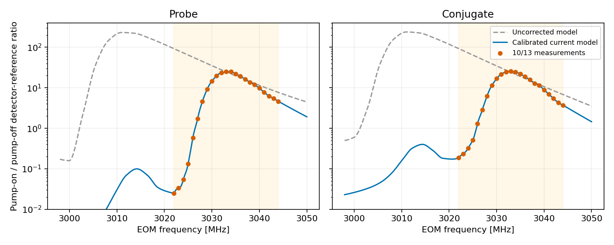

# 실험용 Jasperse·10/13 gain 보정 — 2026-10-22

## 사용자 요청

“실험용 Jasperse 모델과 10월 13일 측정 데이터 기반 gain 보정 토글을 구현해주세요. 피크 위치 보정도 포함하고, 측정 범위 밖이나 운전 조건을 바꿔도 계속 작동하게 해주세요. GC와 분리해서 진행하고 테스트까지 해주세요.”

## 사용

FWM → **DEFAULTS → 2026-10-13 experiment**. 또는 **Empirical gain calibration** 토글ON + **Noise model → Experimental Jasperse**.
**Sim Gold Reference**는시뮬레이션기준설정전체복원. **Save as default**에서이름을붙여브라우저저장또는로컬JSON다운로드.
**Import**에서로컬JSON불러오기. 브라우저저장은해당사이트·브라우저에종속되며사이트데이터삭제시사라질수있음.
보정은OFF가기본, 잡음은Experimental Jasperse가기본. 기존 **Passive L1**은선택가능.
Probe·conjugate gain은보정ON/OFF모두표시. 옛측정보간토글은화면에서제거하고내부분석에만보존.
Advanced의 **Jasperse common cell loss**는양팔gain에서남는공통손실가정을조절. 기본0%는최소비대칭손실폐쇄.
보정ON상태로detuning·온도·pump/seed·waist·길이·교차각·OPD변경가능. 측정밖과기준조건변경은상태표시만변경,토글차단없음.

## ⟦AI⟧ 구현·수식범위

- [Gain helper](../../gabes/fwm_experiment_gain.py), [fit·원자료·재현](../../analysis/fwm_experiment_20261022/README.md).
  10/13측정(10/16전달)양팔23점,공통pump-OFFseed35mV기준.
  현재모델의주파수이동/폭+팔별양의아핀fit+boundedlog잔차계수를사용. 측정밖은**계수**를경계값으로연장하며현재gain은계속변함.
  원자scan밖추가영역은probe1/conjugate0으로접근하는명시적양의연장. 이영역도export에기록.
- [Noise helper](../../gabes/fwm_experiment_noise.py): uniformrealphase-matchedJasperse양팔분포진공적분.
  commontransmission을선언하고나머지를probe또는conjugate비대칭손실에배정하여gain쌍에맞춤.
  보정gain의검출기reference비율을유효sourcegain으로사용하는실험근사. 실제원자공분산을측정했다고주장하지않음.
  수치한계에서맞춤이정확하지않으면boundedloss모형으로dominantgain을보존하고선택지점에**approximate gain match**·residual·모형gain을표시. 유효모델밖을lossless로대체하지않음.
- 기존seedRIN a/shotRIN b/F=1+a/b와후단효율·QE사용. cell손실을total효율로다시곱하지않음. 무검출NF는unavailable.
- focused/headless/fullscan·선택점·livecursor·JSON/CSV에같은선택모형연결. 좁은실측구조는원자재계산없이판독격자만세분화.
- sharedatomic/GC계산경로변경없음. correction은readout-only; 원자rawgain·canonicalM은불변. GC달성기준과별도실험도구.

## ⟦AI⟧ 결과·검증

기준모델23점양팔비율은부동소수오차수준복원(같은자료fit).
보정피크probeδ2.17MHz,conjugateδ2.88MHz; 원시probeplateauδ1.732–2.732MHz·conjugateδ2.732MHz.
다른조건·범위밖의정확도는새측정으로확인할대상이며보정을차단하는조건아님.

실제Playwright화면: [기준조건](../../output/playwright/fwm_experiment_20261022_nominal.png),
[측정밖δ−100MHz·pump350mW](../../output/playwright/fwm_experiment_20261022_extrapolated.png).
브라우저실행오류0;토글·preset·livecursor·바뀐조건의gain/NF·외삽상태확인.
관련검사: gain17/noise31/practicalintegration9. 기존L1전용검사는명시적Passive L1선택으로계약보존.
최종 `python -m pytest -q`: **2627통과·3skip·0실패**,1011.40초. 기존UTCdeprecation경고12개.
[완료receipt](../../output/fwm_experiment_20261022/validation.json), [전체로그](../../output/fwm_experiment_20261022/full_pytest_v20.log).
동결Python425개 전후SHA전부동일. 최종cachev20·선택지점근사상태포함을독립직접byte검수.
[실제브라우저JSON(gzip)](../../output/fwm_experiment_20261022/browser_result_bundle.json.gz)에서도gain/NF/model/근사상태확인.
개발중전체검사2회는최종cache·상태표시수정용으로중단했으며불완전로그로보존. 최종완주로그만완료근거.

[실행 산출물 폴더](../../output/fwm_experiment_20261022/)

커밋 범위 검증: 기존 다른 작업을 제외한 배포 복사본에서 관련154검사 통과·0실패(12.56초).
위2627전체검사는 당시 전체작업폴더 기준이며 이 배포복사본과 구분.
[커밋 검증 receipt](../../output/fwm_experiment_20261022/commit_validation.json).
