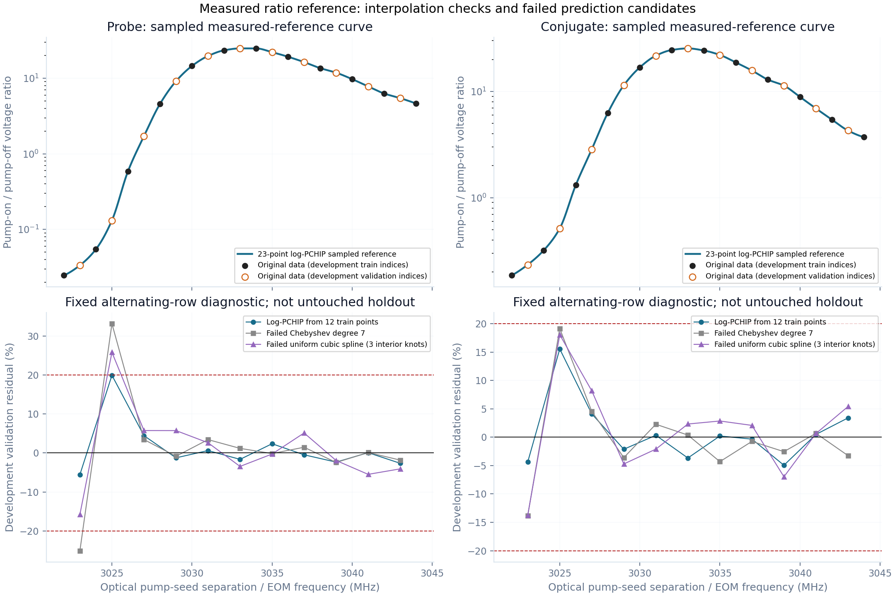

# ⟦AI⟧ 새 23점 양팔 gain 보정 검수

2026-10-16. 사용자 요청: 새 Excel 자료로 재보정, 기존 개발 방법 보존,
이득 기준면·detuning 부호 선확인, probe/conjugate와 Grand Challenge 영향 검수.
아래 방법 선택과 해석은 AI 검토이며 측정 원자료·사용자 직접 확인과 구분한다.

## 기준면·부호

사용자 확인: seed35mV는 펌프 OFF, 셀 통과 후 검출기 앞 측정이다.
온도113°C, 셀 길이12.5mm, pump/seed waist530/330µm, 교차각0.32°는 기본값.
펌프294.804mW, OPD는 F=2→F′=3 기준 약+1GHz(blue), seed는 pump보다 낮다.
양팔·seed는 같은 전압→광파워 환산과 측정 지점, after-cell0.9709를 사용한다.
정밀 OPD·원자 증기 입사 seed는 별도 측정으로 확정되지 않았다.

\[
\delta_{internal}[MHz]=3035.732439-f_{EOM}[MHz]
=-TPD_{sheet}[MHz]-0.267561.
\]

교정량은 \(R_j=V_{j,on}/35\mathrm{mV}=P_{j,on}/P_{seed,off,det}\).
원자 매질 경계 이득 \(g_j\)와의 관계는
\(R_j=g_j\tau_j/(A_0\tau_{ref})\)이며 창·후단 전달은 해당 기준면에 포함한다.
전체 셀 투과0.8046을 원자 pump-OFF 투과\(A_0\)로 대체하지 않는다.
[독립 유도](independent_plane_sign_review.md), [Notion 원기록 검수](remote_reference_review.md).

35mV=3.063457330µW. 명목 비교용 seed3.921545933µW는
\(P_{off,det}/(0.8046\times0.9709)\)로 구한 **외부 셀 입사 추정치**를
atomic input처럼 사용하는 조건부 proxy다. 실측 vapor-input으로 부르지 않는다.

## 원자료와 보정 선택

원본은 변경하지 않았다. SHA-256:
`2653fe73abca75550b2b8665da8c8fff16f5c28f155e029f1e6da155a9409ed0`.
Sheet1 EOM3022–3044MHz의 양팔23점 전압만 사용한다.
Sheet2는 같은 관측을 복제한 분석이며 독립23점을 추가하지 않는다.

- 기존 monotone gain-only minimax 방법은 새 무보정 모델의 주파수별 순서와 맞지 않는다.
  고정 양의 기준면 환산 가정에서 최소 최악 상대오차 하한은 probe99.802%, conjugate98.550%.
  이는 TPD 의존 원자 투과가 미확정인 조건부 반례다.
- 사전 고정 Chebyshev3/5/7차와 uniform-knot cubic spline2/3/4개를 같은 alternating
  개발 train12/validation11점으로 검수했다. 양팔20% 관문은 모두 실패했다.
  최선 joint 최악오차는33.156%와25.813%; probe3025MHz 저신호 tail이 주원인이다.
  [사전 명세](fit_spec.md), [실패 후보·잔차](fit_evidence_review.md).
  [각 후보 실행 당시 명세의 byte identity](declaration_source_identity.json)도 별도로 검산·보존했다.
- 채택은 **23점 natural-log ratio의 shape-preserving PCHIP 보간**이다.
  자유 계수 피팅·측정점 삭제·peak 강제·측정 범위 밖 외삽을 하지 않는다.
  양팔은 각자의 원시 ratio를 사용한다. 측정점 일치는 구성에 따른 성질이며,
  실패한 전역 예측식이나 독립 실험 검증을 통과한 결과로 표현하지 않는다.

[보간 기록](interpolation_record.json)의 동일 alternating 개발 점검은
probe 최대19.922%, conjugate15.545% 상대오차다. 전점 복원·구간별 초과 peak 없음·
지원범위 경계 검사를 통과했다. 모든 점을 이미 본 뒤 선택한 보간이므로
20% 숫자 조건 만족을 사전 예측모델 채택이나 untouched 검증으로 승격하지 않는다.

측정 probe 최대는24.857142857이며 RF3033–3034MHz plateau,
conjugate 최대는25.428571429이며3033MHz다.
내부 detuning은 각각1.732439–2.732439MHz와2.732439MHz.
이전 AI 보간 peak−2.2MHz를 새 실측값으로 재사용하지 않는다.

Sheet1의 잡음19점은 band minimum/부분 추정 SQL을 포함한다.
Sheet2 row28은 NF 대신 gain-fit 오차 row17을 참조하고, Y17 합산은 첫 B17을 빠뜨린다.
끝3점 S/T 적합도 실패했다. 이 자료의 계산 잡음·S/T·옛 gain-linear a는 교정 입력에서 제외한다.
[workbook 독립 감사](workbook_audit/independent_audit.md).

## 코드·사용 범위

새 helper는 양팔 측정-reference ratio를 독립 자료형으로 제공한다.
UI의 `2026-10-13 lab reference (conditional)` preset과
`Measured pump-off-reference gains` 선택에서 사용하며 기본값은 OFF.
선언한 명목 광학 조건과 seed proxy를 채택한 경우에만 활성화한다.
숫자 일치 허용치는 부동소수 변환 오차용이며 실제 장치 허용오차가 아니다.
RF3022–3044MHz 밖·다른 운전 조건은 unavailable이고 외삽하지 않는다.

보정 선택은 표시용 연산이다. raw atomic Gs/Gc, canonical transfer, NF,
ordered-QRT 흡수/방출, SABES 검출 광파워는 원래 모델을 유지한다.
화면·JSON에 두 gain 기준면을 구분하고 NF가 이 gain 보간으로 재보정되지 않았음을 표시한다.
이전 잘못된 coupling/affine 계수는 현행 경로에서 재활성화하지 않는다.

## 검증 상태

Helper27검사, 새 integration+기존 generic52검사,
확장 focused/full·과거 gain fixture·render157검사가 통과했다(서로 중복 포함).
실제 Streamlit preset→checkbox 재실행·정밀 seed proxy slider와 활성 조건도 통과했다.
RF 경계 roundoff만 정규화하고 반대 seed 분기에서는 보정을 차단한다.
[UI 검증](ui_integration_verification.md),
[독립 구현 검수](independent_implementation_review.md),
[화면의 양팔 비교 그림](measured_gain_ui_comparison.png).
[GC release 비교](release_gc_impact_comparison.json)는21진입점·34FWM binding·
94수치 source·대표4payload·37봉인 자료 보존 PASS다.
전체 **2435통과·4skip·0실패**,876.50초:
[코드 검증](code_validation.json), [완료 receipt](full_pytest_receipt.json).
Python281개 실행 전후 SHA 불변, 최종37봉인 자료·원본 workbook·실패 후보 기록 보존:
[최종 무결성](post_validation_integrity.json).
종료 후 테스트 파일1개의 plain/mmap 캐시 차이는 동일 byte 재저장으로 해소했고,
해당29검사를 추가 통과했다. 코드 내용·전체 source SHA 변경은 없었다:
[캐시 점검](post_full_cache_consistency.json), [추가 검사](post_full_cache_related_test.json).
판정: **요청한 측정-reference 양팔 gain 보정·UI·영향 검수 범위 종결**.
새 thermal transport solve0;
명목 무보정 원자 비교는23점+401점의2개 국소 스캔이다.
GC no-fit 예측이나 실제 squeezing 인증으로 보간 일치를 승격하지 않으며,
공식 완료0/4와 frozen v2 FAIL은 유지한다.

다음 물리 질문(제안): 같은 선언 vapor-input에서 finite-seed/infinitesimal ensemble 응답을
비교하면 새113°C 명목조건의 무보정 gain 높이·위치 차이를 얼마나 설명하는가?
독립 A0(TPD)·창/팔별 throughput·입사 seed는 실제 장치 비교의 계측 의존성이다.
