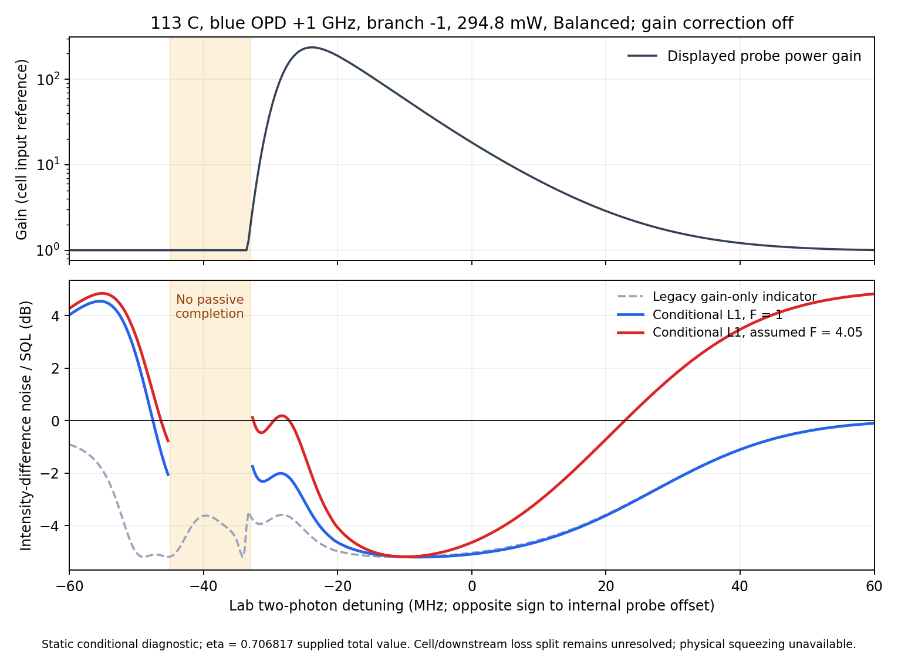

# ⟦AI⟧ GABES 잡음 판독 재검증·패치 검수 — 2026-10-15

사용자 요청: “한번 내용 재검증하고, 문제 해결하는 패치 진행한 후,
grand_challenge에 미치는 영향까지 고려하여 검수해주세요.”
검토 원문: `C:/Users/박수인/Downloads/gabes_handoff_20261014_noise_readout.md`
(Claude 작성, 2026-10-14). 원문 제안과 이번 사용자 확인·검증 결과 구분.

## 사용자 확인

직접 답변: “(1) 네. blue입니다. (2) 낮습니다. (3) Pure 85입니다.
현실적인 문제로 87 0.1%정도 섞였을 수 있음.”
따라서 OPD +1 GHz, seed < pump, `branch=-1` 비교 분기 확정.
⁸⁷Rb 약 0.1% 가능성은 입력 불확도; 이번 pure-⁸⁵Rb 계산에 임의 보정하지 않음.

## 판정·패치

| 항목 | 결과 | 처리·남은 조건 |
|---|---|---|
| P0 운전점 | 사용자 확인으로 해소 | blue +1 GHz·낮은 seed·pure85 |
| P1 손실 판독 | 누락 확인·패치 | 전체 canonical M의 진공 유입 포함; gain-only 키는 호환용 보존 |
| P2 평균장 이득 | 불일치 재현·미해결 | lab −23.7 MHz·Gs236.26 대 인계 측정 약−2.2 MHz·24.9; scalar fit 금지 |
| P3 입력 시드 F | 전달 경로 추가 | 기본 coherent F=1; 4.05는 원문 환산 가정, 같은 RF 대역 측정값으로 채택 필요 |
| P4 고전 잡음 | 미해결 | 기존 pump-scatter 상수는 legacy에만 보존; L1에 자동 혼합하지 않음. N/a는 별도 가정 |
| P5 원자 Langevin | production 미구현 유지 | GC 미시 D·four-sideband 경로와 별도; physical_squeezing_dB=None |
| P6 비수동 구간 | 41/401점 재현·표시 차단 | lab−45…−33 MHz, min eigenvalue−0.226711893. PSD projection·noise clip 없음 |
| P7 기준면 | 명시·추적 | F=cell input, gains=pre-cap photon flux, η=downstream. 인계 totalη 값 유지; cell/window/atomic 분해 미확정 |

P2 Gs236.26은 cell-input 기준, 인계 측정24.9는 pump-off cell-output 기준.
raw비 약9.5는 기준면 환산 전 값. 잠정 t_cell=.792를 쓰면 model/t_cell≈298;
그 투과의 TPD·온도·pump-off 조건이 미확정이라 정량 비교 입력으로 채택하지 않음.

실측 표·9/14 CSV 원본은 이번 세션에서 직접 열지 않음. P2 측정값·F4.05는 인계
문서에 기록된 자료를 사용; 독립 재검증한 범위는 코드·수식·production 재현과 P0 사용자 답변.

`gabes/passive_readout.py` 순수 NumPy 진단. 새 raw 키 `passive_l1_*`,
`passive_completion_*`, `seed_fano_input` 추가. F는 readout-only 입력;
focused/full/headless에서 재평가, cached mean-field 불변. M이 있는 현행 UI는
별도 **Passive L1 noise diagnostic** 사용. 완성 불가 점·그 사이 보간은 unavailable.
legacy `gain_referred_noise_dB`/`S_dB` 및 baseline 파일 그대로 유지.
[401점 전후 실행 비교](legacy_production_parity.json): 패치 전 source를 독립
module로 로드해 현행과 비교; 기존20개 배열 전부 bitwise 동일.
현재 F·추가 N·선택점·status export; nonfinite 값은 JSON null로 저장.

## 독립 수식 검증

`M:(a,b†)in→(a,b†)out`, 밝은 seed, conjugate vacuum, 같은 static M으로
carrier/fluctuations 전파, 두 팔 같은 downstream η:

\[
D=|M_{00}|^2-|M_{10}|^2,\quad T=|M_{00}|^2+|M_{10}|^2,
\quad q=M_{00}^*M_{01}-M_{10}^*M_{11},
\]
\[
S_{src}=\frac{D+(F-1)D^2+2|q|^2}{T},\qquad
S_{det}=1-\eta+\eta S_{src}.
\]

Annihilation-only vacuum endpoint completion에서 exact. 추가 phase-insensitive
creation reservoir E는 분자에 `2||ℓE||²≥0` 추가. 상관된 phase-sensitive
reservoir에는 일반 하한 아님. 독립 CP squeezed-bath 반례: true0.4812 < L1=1.
Seed phase 상쇄는 같은 static M에서 성립; finite RF의 M(0), M(±Ω)는 별개.

독립 물리 quadrature Van Loan 160개 복소1–5구간 프로파일:
S/Fp/Fc 상대오차 최대2.78e−15/1.08e−15/1.82e−15. 별도 ODE·conjugate loss·D=0·
상관 잡음·high-gain 반례 검사. 자세한 유도·조건: [독립 검토](independent_math.md).

`K=J−MJM† ⪰0`은 endpoint 가능성만 판정. 분포형 probe-only loss나
`Λ≤2`를 인증하지 않음. 반례 `M=diag(.9,10)`은 KPSD, |detM|²=81.
`Λ=2|detM|²` 식 자체는 유지; 그 상한·det²=exp(−∫αp)는 local probe-loss
모델 가정 필요. 고이득 음의 eigenvalue를 숨기는 느슨한 tolerance 반례 확인;
판정 tolerance는 `64·eps·max(1,||M||F²)`로 설정, 실제 eigenvalue 보존.

## Production 재현

[설정·행별 값](production_summary.json), [재현 코드](production_check.py).
113°C, +1GHz,294.8mW,seed3.06/(20.3063457/26)µW,Balanced,
closure off,±60MHz/401점. 인계 totalη=0.706817033 유지(이번 사용자 답변은 P0에 한정);
downstream η와 cell transmission 분해 전까지 검출 수치는 조건부.

그림 위 gain은 legacy 표시값. 기존 post-hoc cap은 Gs<1도1로 올리므로
흡수 영역의 raw M gain과 다름. 새 L1은 이를 사용하지 않으며 source photon-flux
Gs/Gc를 별도 제공. 표시 gain을 물리적 투과/이득 교정으로 채택하지 않음.

| lab TPD MHz | legacy 지표 dB | L1 F1 dB | L1 F4.05 dB |
|---:|---:|---:|---:|
| −36.0 | −4.188 | unavailable | unavailable |
| −24.0 | −4.403 | −3.503 | −1.985 |
| −10.8 | −5.189 | −5.179 | −5.179 |
| 0.0 | −5.033 | −5.084 | −4.637 |
| +20.1 | −3.565 | −3.602 | −0.681 |
| +39.9 | −1.098 | −1.111 | +3.462 |

원문 L1 표 재현(반올림≤.01dB), legacy 열은 원문과 약.03–.08dB 차이.
현행 Balanced analytic pump-scatter=.0096014166, 원문=.0042;
[차이 재검산](pump_scatter_normalization.json): 옛 추가 ground-population
factor를 곱하면 .0042042786으로 원문 항 재현. 이번 작업 전부터 있던 absorption
normalization 변경에 따른 차이이며, 두 미보정 항 모두 새 L1에 넣지 않음.
원문 “clip이 SQL 위 잡음을 막음”은
gain-only intrinsic 항에 해당; 별도 ηN/κ를 더하면 legacy 전체도 SQL 초과 가능.
D≈0의 수동 squeezing 자체는 모순 아님; 해당 점에 시드 F만 추가해도
측정 SQL 초과를 설명하지 못함. P2·L2/L3 남음.

전일 F′2 앱 후보도 [명목 재평가](previous_candidate_review.json):
별도 [역사적 설정](../../../analysis/squeezing/operating_point_rb87_f2_20261014/summary.json),
η=.781. Gs4.11665·legacy−5.59397dB 불변; 새 L1 F1−5.31662dB,
조건부 F4.05−4.55070dB. 과거81점 지표 certificate는 역사적 범위 보존;
새 L1의81점 안정성 보증으로 승격하지 않음. Fast adaptive sampling은 기존
gain/legacy noise score로 유지; 새 L1/F의 보간 오차를 인증한 검사는 아님.

## Grand Challenge 영향·검수

[최종 source 전후 비교](final_verified_gc_impact_comparison.json): 21audit import,34transitive FWM
AST/control nodes와 runtime constants,94GC/shared numerical sources 불변.
Foundation/atomic/field/readout 네 native 보고서의 provenance/environment를
제외한 전체 수치 payload 정확히 일치·gate PASS. 37봉인 artifact byte 불변:
regression baseline·thermal plan/source capsule 포함. 신규 transport solve0.

과거 source manifest와 working tree 불일치는 패치 전부터 존재.
strict validator의 거부 동작 유지; 기존 hash/report/ZIP을 새 source 증거로
재승격하지 않음. frozen thermal model `a95cd294…` 유지.
새로 선언하는 thermal source capsule은 helper도 포함한 새 source identity를
사용; 기존 plan/cache의 source identity를 덮어쓰지 않음.
L1은 production 진단이며 GC D 역산·입력·봉인 증거·milestone 판정에 사용하지 않음.
기존 accepted WP 범위·v2FAIL·공식0/4 유지.

코드 검증: [관련140통과](targeted.log), [최종 source93통과](final_source_tests.log).
첫 [전체 실행](full_pytest.log)은 실행 중 source 수정 때문에 thermal source guard3건
거부(2278통과·4skip). 해당 [별도 재검사](source_guard_rerun.log)37통과.
코드를 고정한 [전체 재실행](full_pytest_frozen.log) **2287통과·4skip·0실패**,836.21초.
최종 source hash·명령·전후 결과: [code_validation.json](code_validation.json).

## 총책임자 검토

확인된 판독 결함→조건부 M/F 진단·비수동 표시 차단→해당 구현 범위 **PASS·종결**.
장기 GC 미시 모델·검증 경로는 수치 불변. 실제 squeezing 예측은 미완성.
다음 판별 질문: 확인된 branch−1에서 독립 mean-field response/광이동 검사가
약21.5MHz 피크 위치 불일치와 기준면을 맞춘 이득 차이를 설명하는가?
동시에 실험 입력 ledger에 동일 RF의 F와 downstream η 기준면 기록 필요.

문헌 대조: [Jasperse et al. (2011)](https://arxiv.org/abs/1012.3482)의
분포형 gain/loss 접근과 [Swaim & Glasser (2017)](https://arxiv.org/abs/1703.03438)의
gain 뒤 집중형 loss만으로는 부족하다는 결과와 일관. 이번 식은 위 독립 유도로 검증.
